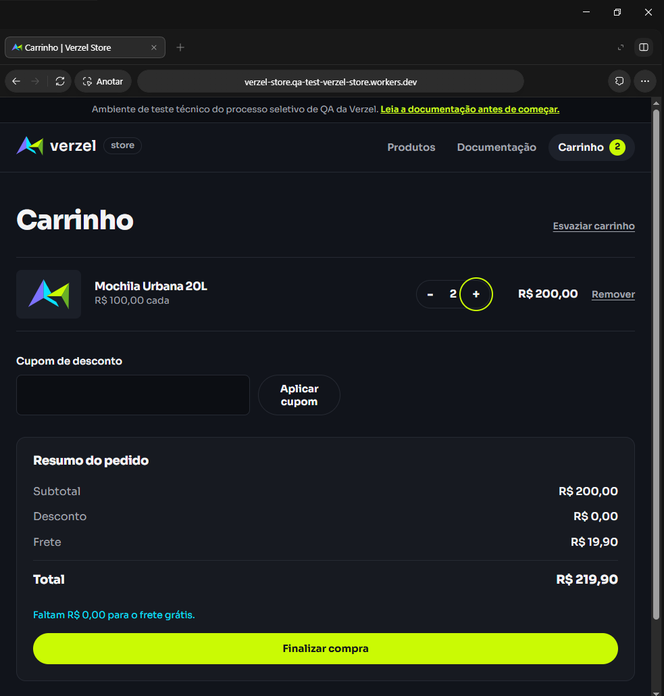
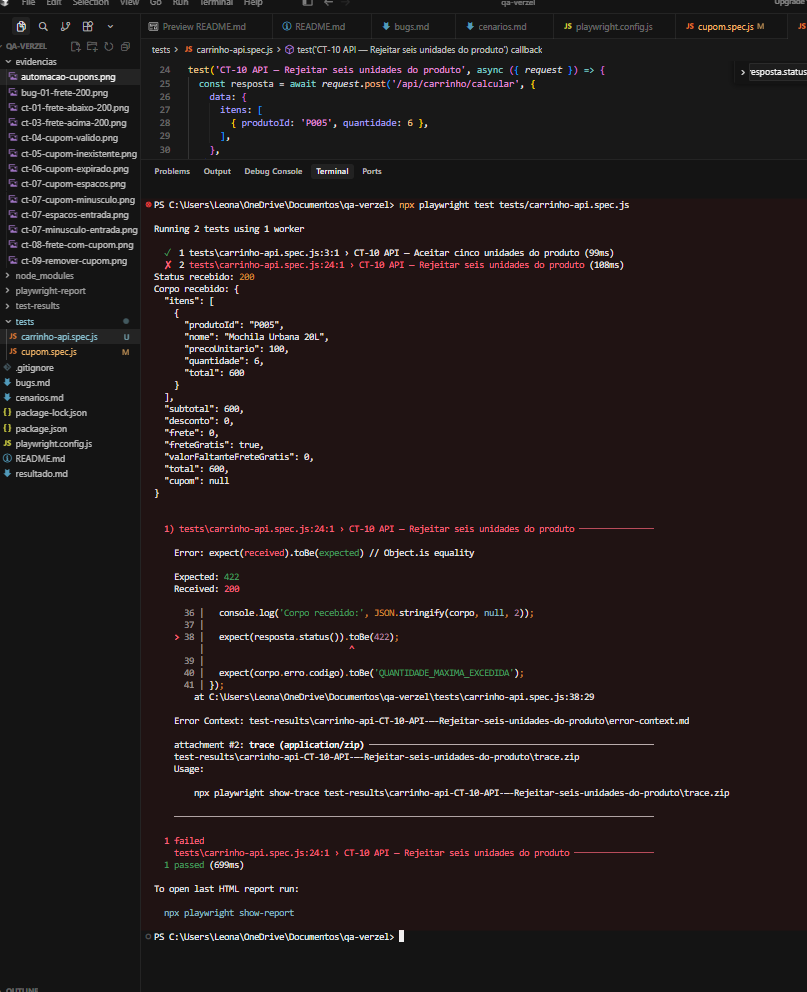

# Bugs encontrados — Verzel Store

## BUG-01 — Frete cobrado com subtotal de R$ 200,00

### Regra esperada
O CA06 prevê frete grátis a partir de R$ 200,00, inclusive.
O CA07 prevê cobrança de frete somente abaixo desse valor.

### Passos para reproduzir
1. Adicionar uma Mochila Urbana 20L de R$ 100,00 ao carrinho.
2. Abrir o carrinho, sem cupom aplicado.
3. Aumentar a quantidade para duas unidades.
4. Conferir o frete e o total.

### Resultado esperado
Subtotal de R$ 200,00, frete grátis e total de R$ 200,00.

### Resultado obtido
Subtotal de R$ 200,00, frete de R$ 19,90 e total de R$ 219,90.
A tela informa que faltam R$ 0,00 para o frete grátis.

### Impacto
O resumo da compra apresenta uma cobrança indevida de R$ 19,90.

### Reprodução
O comportamento se repetiu ao reduzir para uma mochila
e aumentar novamente para duas.

### Evidência




## BUG-02 — API aceita quantidade acima do limite de cinco unidades

### Regra esperada

O CA10 informa que cada produto pode ter no máximo cinco
unidades, tanto na interface quanto na API.

### Como reproduzir

Enviei uma requisição POST para `/api/carrinho/calcular`,
sem cupom, com o seguinte corpo:

```json
{
  "itens": [
    { "produtoId": "P005", "quantidade": 6 }
  ]
}
```

### Resultado esperado

A API deveria rejeitar a requisição com status 422
e código `QUANTIDADE_MAXIMA_EXCEDIDA`.

### Resultado obtido

A API respondeu com status 200 e calculou as seis mochilas.
A resposta trouxe quantidade 6, subtotal de R$ 600,00,
desconto de R$ 0,00, frete grátis e total de R$ 600,00.

Repeti a execução e o comportamento continuou igual.

### Impacto

O endpoint de cálculo aceita uma quantidade acima do limite
documentado, embora a interface impeça adicionar a sexta unidade.

A confirmação de pedido com essa quantidade ainda não foi testada.

### Evidência

