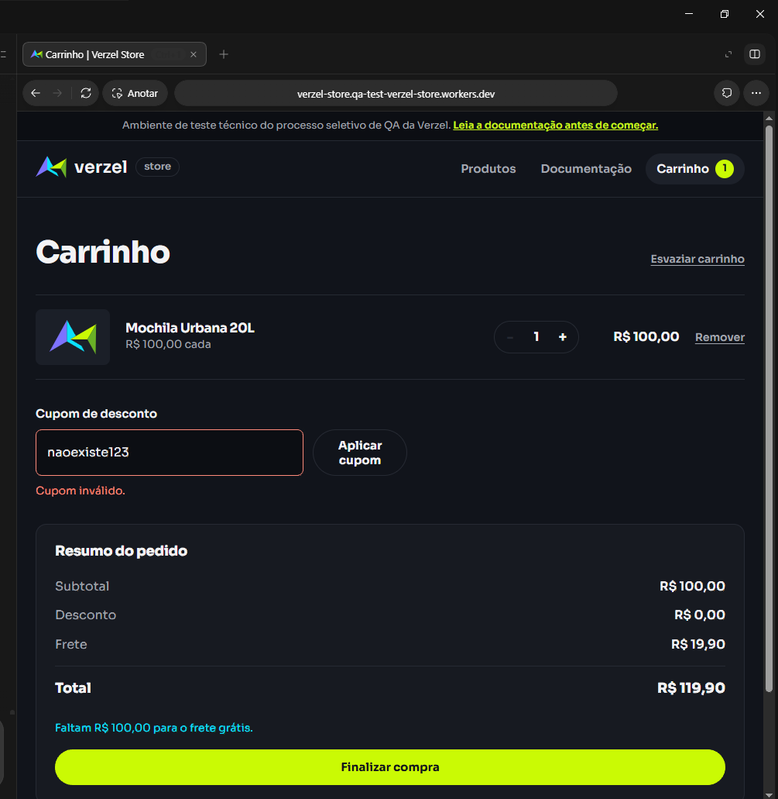
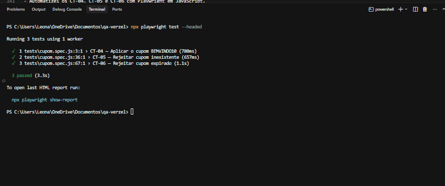

# Resultados dos testes — Verzel Store

## CT-05 — Cupom inexistente

- Tipo de teste: manual.
- Código usado: naoexiste123.
- Resultado obtido: apareceu "Cupom inválido.",
  o desconto ficou em R$ 0,00 e o total em R$ 119,90.
- Status: Passou.

- Evidência:

## CT-02 — Frete grátis com subtotal de R$ 200,00

- Tipo de teste: manual.
- Resultado esperado: subtotal de R$ 200,00, frete grátis e total de R$ 200,00.
- Resultado obtido: subtotal de R$ 200,00, frete de R$ 19,90 e total de R$ 219,90.
- Status: Falhou.
- Bug relacionado: [BUG-01](bugs.md#bug-01--frete-cobrado-com-subtotal-de-r-20000).
- Evidência:

## CT-01 — Frete com subtotal abaixo de R$ 200,00

- Tipo de teste: manual.
- Resultado obtido: subtotal de R$ 100,00, frete de R$ 19,90 e total de R$ 119,90.
- A tela informou que faltavam R$ 100,00 para o frete grátis.
- Status: Passou.

- Evidência:

## CT-03 — Frete grátis acima de R$ 200,00

- Teste manual.
- Coloquei três mochilas no carrinho, sem cupom.
- O subtotal ficou em R$ 300,00, o frete ficou grátis e o total ficou em R$ 300,00.
- Status: Passou.

- Evidência:

## CT-04 — Aplicar cupom válido

- Teste manual.
- Com uma mochila no carrinho, apliquei o cupom BEMVINDO10.
- O desconto ficou em R$ 10,00 e o frete continuou em R$ 19,90.
- O total ficou em R$ 109,90.
- Status: Passou.

- Evidência:

## CT-06 — Cupom expirado

- Teste manual.
- Com uma mochila no carrinho e sem cupom, tentei aplicar VERAO2026.
- Apareceu "Cupom expirado." e nenhum desconto foi aplicado.
- O total continuou em R$ 119,90.
- Status: Passou.

- Evidência:

## CT-07 — Cupom com letras minúsculas e espaços

- Teste manual.
- Na primeira tentativa, digitei "bemvindo10".
- Na segunda, digitei " BEMVINDO10 ", com um espaço antes e um depois.
- Nas duas tentativas, o cupom foi aplicado, o desconto ficou em R$ 10,00 e o total em R$ 109,90.
- Status: Passou.

- Evidências:

Entrada em minúsculas:

Resultado:

Entrada com espaços antes e depois, conforme registrado no teste:

Resultado:

## CT-08 — Frete calculado antes do desconto

- Teste manual.
- Coloquei uma mochila, uma garrafa e dois kits de meias no carrinho.
- O subtotal ficou em R$ 209,80.
- Apliquei BEMVINDO10: o desconto ficou em R$ 20,98 e o total em R$ 188,82.
- O frete continuou grátis.
- Status: Passou.

- Evidência:

## CT-09 — Remover cupom

- Teste manual.
- No mesmo carrinho do CT-08, removi o cupom.
- O desconto ficou em R$ 0,00 e o total voltou para R$ 209,80.
- O frete continuou grátis.
- Status: Passou.

- Evidência:

## CT-10 — Limite de cinco unidades por produto

- Teste manual pela interface.
- Aumentei a quantidade de mochilas até cinco.
- O botão de aumentar ficou desabilitado no carrinho.
- No catálogo, o botão de adicionar também ficou desabilitado e apareceu "Limite de 5 unidades atingido."
- Ao reduzir para quatro, consegui adicionar outra mochila até chegar a cinco novamente.
- Status: Passou.
- A validação desse limite pela API ainda não foi testada.

## Testes automatizados

- Automatizei os CT-04, CT-05 e CT-06 com Playwright em JavaScript.
- Os testes verificam cupom válido, inexistente e expirado.
- Executei pelo terminal com o comando:
  `npx playwright test --headed`
- Resultado: os três testes passaram.
- Código dos testes: [cupom.spec.js](tests/cupom.spec.js).

